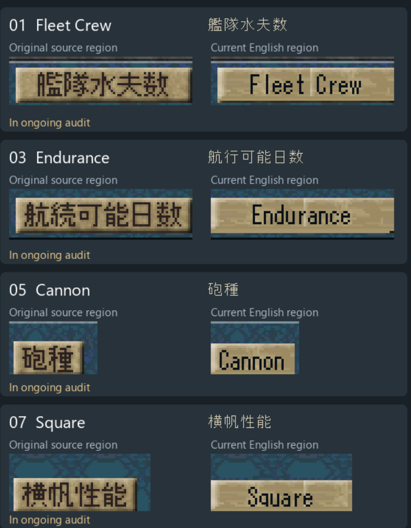

# Open defect: translated plaque backgrounds

Reported by the user on 2026-10-14. This affects the audit of **all translated
wooden/textured plaques**, not only the four examples in the supplied sheet.
All 18 existing plaque/hint entries remain incomplete. The extent on other
plaques requires individual source comparison.

## Visual evidence

The English backgrounds have larger pale pixel blocks and a different texture
pattern from the Japanese originals. Fleet Crew shows a vertical streak between
its words; Endurance shows one near the r. Cannon and Square also illustrate the
background mismatch. These are background restoration defects, distinct from
translation or glyph completeness.

## Confirmed implementation and verification limits

`scripts/prepare_plaque_style_v247.py:21` creates paper from a town-information
donor, repeating the interior with modulo coordinates and remapping its palette.
The plaque loop replaces each entire plaque rectangle with that donor tile.
This establishes that the original individual plaque backgrounds are replaced.
The exact source of each reported streak has not yet been isolated pixel by pixel.

Prior native checks against `paper()` demonstrate that the generated background
was drawn as specified. Font-mask and bevel checks remain useful within their
scope, but cannot establish faithful restoration of the Japanese source texture.
The audit's broad matching-texture claim is withdrawn pending correction.

## Required correction and review

Preserve each original plaque's texture and bevel wherever recoverable. Limit
reconstruction to regions obscured by the original Japanese lettering, using
appropriate local source texture. Check all translated plaques for repeated
patches, oversized pale blocks, seams, and vertical streaks, including text gaps
and letter edges. Review original and translated crops at native resolution and
an enlarged scale, then verify the corrected artwork in the game.

This report records the defect and its review gate; it does not claim a graphics
fix. No ROM or graphics batch is changed by this documentation update.

## V541 investigation and prototype

Inspection of the actual accepted donor shows an already translated Type label,
not the original Japanese source. Its materialized background replaces 49
English ink pixels, and the resulting interior is reused across the plaques.
The donor itself also differs from the clean Japanese atlas; the origin of
all its earlier texture changes is not yet fully mapped.

`scripts/probe_plaque_source_texture_v541.py` builds research-only indexed PXL
prototypes from blank clean-ROM Share strips [2,62,43,74] and [85,62,124,74].
The strips exclude text and the dark right bevel. Their combined 80 columns
cover every tested interior without horizontal repetition. The join at column
41 is a reconstruction choice, not an exact recovery of concealed pixels.

All 17 English masks match V540 exactly. Existing bevels, palettes, dimensions,
and pixels outside plaque interiors match V540 exactly. Palette remapping has
at most one BGR555 step (8 displayed RGB levels) of channel difference. Visual
review shows finer grain and removes the conspicuous coarse interior bands.
It does not validate the inherited bevels or every original plaque texture.

Evidence and both review sheets are in `work/analysis/plaque_texture_v541/`.
The native-label census includes accepted historical batches and current
profile batches; it is a classification list, not 20 distinct affected screens
or proof that every listed asset is wooden. Embedded copies and dynamic hints
still require separate inspection. No ROM or registered batch changed.

## V542 integrated correction

The 17 tested interiors now use the original source grain in registered V542.
Two overlapping crew rows were corrected after the V541 prototype review; its
local research artifacts have been regenerated to include that correction.
All 61 native plaque crops and 17 full font masks pass. Existing bevels remain
unchanged, and other plaques/dynamic hints remain open. See the
[V542 checkpoint](plaque_texture_v542_checkpoint.md). This global defect is not
closed by the 17-plaque correction.

## V543 dynamic paper correction

The heading, short Weapon/Armor hints, and long item hints now use the original
fine grain inside existing tile/helper slots. Five occupied slots and three
short/heading hints pass native pixel/letter checks, and all 235 bounded widths
pass on both controlled framebuffers. Original bevels are retained; inherited
town plaques and other background families still need review/correction. The
global defect remains open. See the [V543 checkpoint](equipment_texture_v543_checkpoint.md).

## V544 town/faction frames and future authoring rule

Six town and five faction plaques now retain original frames and visible source
grain. Distorted faction rectangles are restored; native crops and complete
English masks pass. The source-based [texture workflow](plaque_texture_workflow.md)
is now part of build continuity, preventing reuse of the already translated Type
background for new authoring. Seven additional families are inspected as examples;
treasure and other contexts remain open. All 18 original audit entries remain
incomplete. See the [V544 checkpoint](town_force_texture_v544_checkpoint.md).

## V545 treasure header

The treasure header restores visible source grain and reconstructs its hidden
strokes from the same asset and row. Actual display preserves all158 English
ink pixels above the unchanged native divider. The remaining global background
and original-border/style review stays open; all18 entries remain incomplete.
See the [V545 checkpoint](treasure_texture_v545_checkpoint.md).

## V546 actual native bevels

The old donor included wallpaper and lacked the genuine right bevel. The17
localized plaques and all equipment hint widths now use clean frame edges from
[8,20,48,36], with existing geometry/English/interiors retained.61 native crops
and eight hints pass. Source bevel and current rendering are verified; the
global family/context review and all18 audit entries remain open. See the
[V546 checkpoint](plaque_borders_v546_checkpoint.md).

## V554 local plaque texture review

Compared original/current wooden plaques and reviewed17 translations. A3327-pixel
per-pixel restoration passes letter/palette/border checks but leaves Japanese
glyph-shaped texture seams and is rejected. A conservative424-pixel source-margin
alternative has no observed ghosts in the review sheets; native/game verification
remains pending. No artwork or ROM shipped. Workflow now explicitly rejects
ghosted texture restoration. V546 unchanged; all22 requirements and18 incomplete
plaques retained. See [V554 checkpoint](plaque_source_review_v554_checkpoint.md).

## V555 integrated original plaque margins

Registered combined V555 restores424 exact original texture pixels in10 plaques,
retaining protected reconstruction bands to avoid Japanese-shaped seams. All17
complete English masks and61 actual native plaque crops pass;56 unique startup
regression frames remain identical to V546. Only the two plaque atlases change;
all code and other translations stay exact. Exact clean-ROM patch reconstruction
passes. ROM/patch and guide-candidate screenshots are saved on E. Experimental,
no canonical promotion. All22 requirements and18 incomplete plaques retained;
global family/style review and other graphics gates remain open.
See [V555 checkpoint](local_plaque_release_v555_checkpoint.md).

## V556 Ships plaque material defect and prototype

All11 Ships plaques still contain broad pale horizontal bands. A source-based
research prototype corrects their grain/borders and overlapping erase remnants,
preserving all11 accepted English masks and positions. Hull's original divider
is tested separately from ink-coloured glyphs. Name-entry gradients and fleet
wallpaper are separate materials; five labels/rows each received visual review.
Prototype native runtime overlays and full integration remain pending. V555
unchanged; all22 requirements and18 incomplete plaques retained.
See [V556 checkpoint](plaque_families_v556_checkpoint.md).

## V557 integrated Ships plaque texture correction

All11 Ships faces now use fine original grain/native bevels with overlapping
erase remnants removed. Six complete observed screen composites pass589824
pixels without exclusions; all66 full label appearances and Back/re-entry pass.
Both cargo icons bind to the actual original itemtrade16 resource; all512
displayed source pixels match. Their observed8-row seam repeats source row7;
the producer cause remains untraced.56 unique startup frames remain identical
to V555. Only shipinfo.pxl changes; exact clean patch reconstruction passes.
Experimental V557 and reviewed screenshot saved on E; all22 requirements and18
incomplete original plaques remain retained. Global material/context review and
other graphics gates remain open. See [V557 checkpoint](ship_plaque_release_v557_checkpoint.md).

## V558 source-specific name plaque gradients

All5 name plaques now retain their own original gradients,frames and full English
masks.284 source material pixels are restored;2013 nonwhite original material
pixels outside English ink match exactly. Embedded SLACK block12 is synchronized,
with original palette flag differences preserved. Six complete native source-
opcode fixture composites pass589824 pixels,including all transparent points
and30 full label appearances. Ordinary event reachability remains open.56 unique
startup frames remain exact to V557; clean patch reconstruction passes. V558 is
experimental; ROM/patch and controlled test screenshots saved on E. All22
requirements and18 incomplete original plaques retained.
See [V558 checkpoint](name_gradient_release_v558_checkpoint.md).

## V559 fleet wallpaper and actual Swap Ships view

All5 fleet label masks and4000 independent source-donor pairs pass; no coarse
material defect is found. Ordinary Shipyard > Dock > Swap Ships binds actual
dock.pxl view/cache and verifies111360 source pixels across three frames,including
12 complete Ship2–Ship5 labels. Occupied Flagship is occluded by its ship card;
the broader256-pixel border mismatch is retained and not credited. Original
source save unchanged; no ROM change. Screenshot saved on E. V558 stays current;
all22 requirements and18 incomplete original plaques retained.
See [V559 checkpoint](fleet_wallpaper_v559_checkpoint.md).

## V560 live Common-wheel OBJ provenance

All6 ordinary Common captions and source bronze materials pass.6144 source OBJ
bytes bind to actual VRAM bankE, six OAM entries and standard palette banks0/1.
All8150 visible composite pixels match. The actual opaque sprites cover all1044
repaired marker-caption points in this state, explaining the earlier unchanged
live lettering. Embedded marker indices match; unobserved consumers/animation
and action controls remain open. Read-only palette export added to test harness;
no ROM change. Screenshots saved on E. V558 current; all22 requirements and18
incomplete original plaques retained.
See [V560 checkpoint](radial_obj_v560_checkpoint.md).

## V561 shared action-control material audit

All22 stored controls pass1447 complete glyph pixels and bounds;65536 embedded
frame indices match. All83 palettes remain original, and7 miniature captions
have exact index-zero backgrounds.3239 visible source material points match
under a conservative Japanese face/shadow mask. A323-pixel reconstruction
alternative has no verified visual improvement and stays research only. Two
exact-origin native-view censuses are bounded negatives, not global non-use;
actual parents/crops remain open. V558 unchanged; all22 requirements and18
incomplete original plaques retained.
See [V561 checkpoint](action_materials_v561_checkpoint.md).

## V562: original date graphic consumer

The original 32x16 frame crop and actual resident atlas now resolve for the M/D
date initials. Three ordinary V558 town/Port/Sail frames pass six complete glyph
appearances,102 ink points and264 full-cell ink/blank pattern checks. Source save
unchanged; no fixture or cheat used. The other five miniature captions still need
actual consumers. All18 plaques and22 historical requirements remain open with
full scope retained; current ROM remains V558. See [V562 evidence](date_consumer_v562_checkpoint.md).

## V564: Temporary Storage source wood and shadow correction

Ordinary Cargo Setup exposed 125 retained Japanese shadow points behind the
English wooden banner. The registered source-local repair changes 275 pixels,
preserves all 241 English ink points and 3,555 visible source material points,
and retains all prior code/artwork, 470 batches and 114 accepted layers. Two full
native screens and 8,192 banner pixels pass, as do 56 unchanged startup captures
and exact clean-ROM patch reconstruction. Guide candidate saved on E. Current
experimental ROM is V564; all 18 original plaques remain incomplete and all 22
historical requirements retain full scope. Five miniature native consumers
remain open. See [V564 checkpoint](cargo_banner_v564_checkpoint.md).

## V566: Distributed Goods and Spoils original wood repair

Two related headers retained 203 uncovered Japanese shadow points. Source-local
repairs change 412 pixels while preserving 341 complete English ink points and
7,393 original visible material points. Original code retains full 256x16 crops;
four explicitly substituted native renderer cases pass 16,384 banner pixels and
complete surrounding screens. Original event reachability remains unverified.
All 56 ordinary startup captures and exact clean-ROM patch reconstruction pass.
Current experimental ROM is V566, with all 470 batches and 114 accepted layers.
All 18 original plaques remain incomplete and all 22 historical requirements
retain full scope. Test screenshots saved on E. See [V566 evidence](header_wood_v566_checkpoint.md).

## V567: original wooden-header consumers

Original Distributed Goods/Spoils resource owners and full crops now pass eight
actual emulator cases under a one-word header-choice test cheat. Every resident
PXL matches its named ROM file, and all 32,768 banner pixels plus 786,432 complete
screen pixels match independent controls. No resource-file substitution occurs.
Ordinary reward/battle event coverage remains unverified; the underlying test
scene stays Cargo Setup. Production V566 is unchanged. All 18 plaques remain
incomplete and all 22 historical requirements retain full scope. See
[V567 native-consumer evidence](header_consumers_v567_checkpoint.md).

## V569: marker price ownership and original bag restoration

Original sale/buy price writing occupies two 12-pixel rows. Historical Disc./Buy/
Sell boxes assumed 16-pixel rows and wrote Sell over a bag illustration. The
registered correction supplies complete Sell/Buy headings, restores all 1,600
original bag pixels (369 repaired), and changes 703 indices in both loose and
embedded marker copies. All other art/code/translations remain exact V566. Four
controlled original-resource crop cases, 56 unchanged startup frames and exact
clean-ROM patch reconstruction pass. The ordinary Market Trade attempt lacked a
contract and is not price-display evidence. The rejected first test setup and
its corrected zero palette/flags are documented. Current experimental ROM V569;
all 18 plaques remain incomplete and all 22 historical requirements retain full
scope. See [V569 source-ownership evidence](marker_ownership_v569_checkpoint.md).

## V571: complete smaller marker headers

Original standalone glyph geometry proves complete 64/48-pixel marker panels for
Temp Storage, Issued and Spoils. The old Issued/Spoils boxes missed 27 Japanese
edge pixels. Source-locked repairs remove them, retain 1,528 original visible
material points, and supply 282 complete native-font ink points. Both loose and
embedded marker copies change 993 indices; all other artwork/code remains exact
V569. Four controlled source crops, 56 unchanged startup frames and exact patch
reconstruction pass. Original header contexts remain unverified. Current
experimental ROM V571; all 18 original plaques remain incomplete and all 22
historical requirements retain full scope. See [V571 evidence](marker_headers_v571_checkpoint.md).

## V573: original Confirm material and complete native English

The separate Confirm button retained Japanese-shaped black shadows. Its repair
reconstructs 190 hidden points from two-sided original shading controls, retains
674 original visible material points and the full original frame/palette, and
supplies 86 complete native-font ink points with proper English shadows. Only
217 pixels in kakutei.pxl change from V571. Concealed shading is inferred. Four
controlled native cases pass 3,524 opaque points plus preserved original
transparency, two paired full screens, 56 unchanged startup captures and exact
patch reconstruction. The first test's opaque-black assumption for transparent
index14 was corrected using the original packed palette flag; no ROM change was
needed. Full 470-batch/114-layer stack retained. Current experimental ROM V573;
ordinary Confirm-parent contexts remain open. All 18 plaques remain incomplete
and all 22 historical requirements are unchanged. See
[V573 checkpoint](confirm_material_v573_checkpoint.md). Screenshots saved as test
fixtures on E; graphics goal remains active.

## V574: all 18 original/current native plaque comparisons

Paired clean Japanese/V573 cold boots on the same isolated Syracuse save now
show all 18 plaques in actual ordinary UI, including the six Japanese runtime
stat labels and original Equipped Items hint absent from stored-art comparisons.
All 17 complete English font masks, 14,272 static plaque pixels and 3,552 native
heading/Weapon/Blue Oak Shield pixels pass. Source save remains unchanged; no
code/location/inventory/condition fixtures were used. Both enlarged comparison
sheets were visually reviewed, with no new large pale blocks, distinct vertical
streaks or missing letters identified in these observed crops. Source-hidden
grain remains inferred. Fresh preservation checks pass all 921 PXL/FLS entries,
all indexed palette banks and all 57 embedded block extents. Two sheets/eight
paired full captures and four ordinary guide candidates with provenance are on
E. V573 remains current; all 18 entries remain incomplete and all 22 historical
requirements are unchanged. Five miniature-caption consumers and other legacy/
FLS/context requirements remain open. See [V574 paired native evidence](plaque_native_comparison_v574_checkpoint.md).

## V581: original equipment wood repeat joins

Fresh maximum-width equipment captures exposed a pale column repeating every40 pixels. The shared source wood sample now starts one original pixel inward;328 tile words change, with all code, borders, palettes and other ROM files exact V573. Five category-maximum names and three empty hints pass13,280 whole-paper pixel checks, all5,120 icon pixels,470 native painter widths/nine fallback contracts,56 unchanged startup frames and exact clean-ROM patch reconstruction. The source/copy saves remain exact; inventory setup is synthetic. Paired screenshots/provenance are on E under Test fixtures/V581 Equipment wood joins. Current experimental ROM is V581 with all470 batches/114 accepted layers. All18 original plaques remain incomplete and all22 historical requirement objects retain their exact scope. Five miniature consumers, Confirm parent and other legacy/event/movie/material gates remain open. See [V581 source and native evidence](equipment_wood_join_v581_checkpoint.md).

## V586: every equipment name in native Sailor Info

A14,360-frame V581 cold boot with28 bounded original-transfer equipment fixtures
now verifies all103 native equipment names:28 weapons,26 armor and49 accessories.
All140 actual hint appearances (103 occupied/37 empty) pass205,088 complete paper
pixels, full first/final letters/spaces and105,472 original icon pixels. Captured
slots/categories/names/owners and every fixture replay match; source saves and
ROM/patch remain unchanged. Seven fullscreens were visually reviewed. All140
unmodified selected screenshots/proofs/provenance are on E under Test fixtures/
V586 All equipment hints. This is Maria display coverage with explicit slots,
not normal acquisition/eligibility, every character/condition, guide approval or
global graphics completion. No new empty-Weapon case is claimed; the earlier
V581 case remains separate. All18 plaque entries remain incomplete and all22
historical objects retain exact scope. See
[V586 complete catalogue evidence](equipment_catalogue_v586_checkpoint.md).

## V590-V591: ordinary inspection and consistent Quarters plaque

The same Vestaros brigantine displayed Marines1 in Ship Info and Quarters1 in
Assign Sailors. Original 海兵詰所 denotes marine quarters, not the number of
marines. Registered V591 changes that one Ship Info label to Quarters:144 glyph
indices, with all other texture/frame/palette/geometry and ROM files exact to
V581. All470 batches/114 layers and921/57 preservation scope carry forward.
Twelve complete paired ordinary cold-boot frames check1,179,648 pixels; three
full1,008-pixel faces and complete100-point words pass, with original cache/view
bindings and first/final erasure controls. The clean patch reconstructs V591
exactly. Two unmodified final guide candidates and control comparisons are on E,
with publication unapproved. Donor save remains exact; no synthetic fixtures.
Admiral wording, miniature/Confirm parents and other graphics gates stay open.
All18 plaques remain incomplete and all22 historical objects remain exact.
The graphics goal remains active. See [V591 checkpoint](ship_quarters_v591_checkpoint.md).

## V592-V593: source-reviewed Battery/Batteries and Quarters labels

Original Help129 and actual Deck selections establish gun positions that accept
a Gunner, separate from individual cannon counts. Ship Info now says Batteries;
the individual Deck room says Battery, and its marine room now says Quarters.
Only139 plaque indices and15 bytes in two existing12-byte ARM9 text slots change
from V591. Original frames/grain/palettes/geometry and all code/fonts remain exact.
Eighteen complete source/empty-control/final Deck cases check3,538,944 RGB pixels
and eight complete labels; four missing-end-letter controls fail as expected.
Twelve ordinary ship frame pairs check1,179,648 native5 pixels, three complete
1,024-pixel Batteries faces and exact resident-file bindings. Full inherited
470/114 stack and921/57 preservation carry forward; the clean patch reconstructs
registered V593 exactly. Three final ordinary guide candidates are on E with
publication unapproved; empty-heading research controls stay in Test fixtures.
This closes the specific V556 gun/marine-room terminology lead, not the broader
graphics audit. All18 plaques remain incomplete and all22 historical objects
remain exact. See [V593 checkpoint](ship_batteries_v593_checkpoint.md).

## V600: corrected score owner and original result-parent evidence

The old V164 selector test mispaired adjacent initializer literals. Executing
the full original initializer proves owner023139FC is deckchip15, whereas the
real deck04 score owner is02313A38. The old score-selection interpretation is
superseded; historical font/generator evidence remains separate. Original
score setup0200C14C/painter0200C054 now bind both complete24x24 label cells.
Three explicit research cold boots run the unmodified original result selector
and animation with10 Won/2 Lost/12 total, preserving real owner/crops/getters.
All three complete resident score files and native one-shot guards/counters
pass. All94 English ink points and a separate live centered-controller snapshot
pass. Across the451-frame triple window,323 frames pass both entire native5
composites (63,504,384 positions);99 are wholly unchanged. Twelve unanchored and
17 failed whole comparisons retain exact diagnostics and remain unresolved.
Across2905 original/current pairs,2552 are wholly identical. No adaptive frame
shift, earned result, normal guide or every-animation-frame claim is made.
Twelve full research screenshots/proofs/provenance are on E. Production V599,
its patch, artwork and registry remain unchanged. All18 plaques remain incomplete,
all22 historical objects remain exact;the wider goal stays active. The build
protocol now requires actual initialized filenames/resident payloads rather than
adjacent-pool pairing. See [V600 score evidence](score_parent_v600_checkpoint.md).

## V601: original score clipping and native bitmap-plane follow-up

Six fresh research cold boots reproduce all observed V600 screenshots exactly.
Both entire200-byte live score objects match across three variants at all33
primary frames. Complete unclipped unchanged digits provide unique positions;
the original parent/adapters/getter/blitter replace the incorrect generic host
crop model. All29 prior score-label cases now match native rendering.48 entire
native5 composites pass. Nine final-image cases still differ over the existing
crew figure, but all18 source/current cases pass both complete49152-pixel bitmap
planes byte for byte, including bit15 (3,538,944 bytes). OAM and non-bitmap texture/
palette banks are exact. The precise foreground timing/raster cause remains
unproved and full final-frame equality is not claimed. No frame is silently
retimed. Twelve full research screenshots/reports/provenance are on E, with no
ordinary guide or earned-result credit. Production V599, patch, assets and registry
remain unchanged. All18 plaques remain incomplete;all22 historical objects retain
exact scope;the wider graphics goal remains active. See
[V601 native clipping and planes](score_boundaries_v601_checkpoint.md).

## V611: additional plaque repairs; native regional context remains open

Original/current atlas review finds retained Japanese upper strokes, row-filled
grain and incomplete rims in the regional-fleet plaques. The compiled complete
V611 asset repair changes only chihofleetinfo.pxl (3,333 indices), with five
complete native-font masks/424 ink points, ten end-letter negatives and 1,144
own-source rim samples. Wording now reads Level/Income/Expenses/Invested/Mission.
All code, memory/pool layout and other translations remain exact V610. The full
470-batch/114-layer builder, exact clean patch, fresh 921/57 preservation and 19
ordinary regression frames pass. The early source-binding guard failure and
subsequent MemoryError are retained; the complete retry succeeded.

Native display remains UNVERIFIED. A short setup stopped before Info; two full
17,200-frame original-backdrop-selector research runs reach Fleet Info but show
no regional atlas: all three whole pairs match, the PXL is not resident and no
declared live backdrop view exists. No plaque-display, regional-formation, guide
or earned-progress credit follows. V610 stays the latest verified candidate;
V611 is experimental pending its actual native context. Golden Route and Save/
Load material defects are newly recorded and remain unfixed. Ten unmodified test
captures, source comparisons and hashed evidence are on E. All 18 original plaques
remain incomplete and all 22 historical objects retain exact scope; full goal
active. See [V611 checkpoint](regional_plaques_v611_checkpoint.md).

## V612: Save/Load source-frame repair and actual normal display/load verification

Both 40x16 Level/Power plaques now retain all 416 original rim samples at their
original coordinates and use contiguous source wood without repetition. All 123
native-font ink points and four end-letter negatives pass; 1,037 indices change
in saveloadinfo.pxl only. Registered V612 retains the complete V611/470-batch/
114-layer stack with all code, pool layout, other art and dialogue exact.

Paired original Japanese/V611/V612 cold boots on the unchanged isolated Syracuse
save exercise normal Save/Load, cancellation, all six actual stylus previews and
Yes loading of the first existing save, returning to Stockholm. All 18 active
states pass 26,568 complete source/final restoration pixels. All 32 sampled whole
current/control pairs pass 3,145,728 native5 positions; 36 original native getters
bind the real views to complete named PXL files. The original flag is a halfword;
source constructor/read opcodes correct the first verifier's zero-word assumption
without a ROM edit. No synthetic fixture, new travel/acquisition or hardware claim.
All 19 ordinary New Game/Market frames, 921/57 preservation, full manifest, exact
clean patch and Ruff pass. Fifteen audit captures and five ordinary guide candidates
are saved on E with provenance; publication remains unapproved.

V612 is the latest compiled combined experimental work. Its inherited regional-
fleet native context remains open, so V610's latest-verified pointers are retained.
Golden Route material/wording and other graphics gates remain open. All 18 original
plaque entries remain incomplete and all 22 historical objects retain exact scope;
goal active. See [V612 checkpoint](save_load_plaques_v612_checkpoint.md).

## V613: Golden Route Discovery and both Records source-frame repair

Three Golden Route atlases now retain source frames and fine original grain in
place of broad fills, missing rims and a residual Japanese stroke. Eight complete
headings read Goods / Profit % / Reward / Total Rewards. The total qualifier is
retained; original data/calculations remain unchanged. All715 independent font
points,16 end-letter erasure controls and2928 source frame samples pass;5027
indices change. Discovery's percentage face expands40 to44 pixels, ending before
its live value. Hidden grain remains explicit reconstruction, not recovered art.

Actual original Records controls exercise both modes and all five rows. A separate
ordinary New Game buys Salt, then an authorized isolated cost-word fixture triggers
the original sale, tutorial and Guild reporting path. Original record states1,2,3
and the real Golden Route Found screen are observed. No earned trading/profit/
travel/payment/user-save progress is claimed. Source comparison uses a separately
labeled V612-code/original-three-atlases control, not a clean Japanese playthrough.
All39 actual view/getter bindings,63 whole current/source screen pairs and19
ordinary no-fixture New Game/Market regression frames pass. All470 batches114
layers,921 graphics formats/palettes and57 embedded extents remain; the exact
clean-ROM patch reconstructs V613. Thirty-nine unmodified fixture captures,
source comparisons, schedules and provenance are on E.

V613 is experimental with V611's regional native context still open; V610 remains
the latest verified pointer. All18 original plaques remain incomplete, all22
historical scopes exact, and wider graphics/movie/legacy/gameplay gates remain.
Full goal active; canonical unchanged. See
[V613 Golden Route checkpoint](golden_route_plaques_v613_checkpoint.md).

## V616: actual regional plaques, Ship Name callers and guarded policy prompts

Original Shipyard/Dock controls form Manuel's regional fleet using three bounded
prerequisite fixtures, preserving Gerhard's refusal. Normal slot6 Save and cold
reload retain it; the source donor is unchanged. World Map Fleet/Village selection
finally exposes all5 regional plaques. Original formation verifies24912 full-region
pixels; V616's independent Japanese-art control verifies11 complete screen pairs,
including4 active regional states and16608 full-region pixels. This closes the
previous missing display context, not the remaining policy/financial variants.

The coordinated V615 source repair adds both Ship Name captions,4 policy choices,
mission/confirmation text and8 complete native prompts. Native127/128 had split
one English sentence;133 was an unrelated save fallback. Actual Patrol/Dock then
expose mid-word physical wrapping despite previews. V616 reuses the existing
guarded word wrapper for all8 IDs. All3668 IDs and40 other-parent controls pass;
only127..134 gain wrapping,original321/327 remain. No section/pool/cache grows.
Actual corrected notices retain complete have/under and equal x22 line origins.
Both original purchase/rename Ship Name callers and all4 menu labels pass complete
font/blank-cell masks. The ordinary24100-frame no-fixture New Game/Market run
matches all19 whole V613 screens. Full470/114 integration,921/57 preservation and
exact clean patch pass; screenshots,source controls and failed V615 cases are on E.

V616 remains experimental. Attack Town and132..134 gameplay branches,all4 order
confirmations,other mission descriptions and nonzero monthly values remain. All18
original plaque objects and22 historical scopes are exact and incomplete; V610
verified pointers/canonical stay unchanged. Broader graphics gates and the later
older-record review remain open. See [V616 checkpoint](regional_ui_v616_checkpoint.md).

## V617: complete regional order guards and actual mission/financial variants

V616's actual assignment lost Stockholm's initial S after a bare newline. V617
guards both original newlines only in the original assignment caller after macro
expansion. All3668 IDs,11 other direct callers,112 field variants and5 malformed
controls pass. The source-specific ordinal now reads Fleet 2 Admiral; proper
fleet names remain unchanged. No pool/cache/section/startup/arena growth occurs.

Actual original controls verify all4 complete three-line confirmations,all4
mission labels/descriptions and notices128/131/132/133/134. All5 plaques across4
states pass16608 complete native pixels. Existing war with faction5 permits the
Hamburg attack; no war/input logic is changed. Exactly12 isolated finance bytes
test complete9/10-digit values including4294967295; all480 digit ink points pass.
These are display fixtures,not monthly earnings or earned progression. The role
foreground and all1152 native5 background/foreground/shadow pixels pass in each
of4 mission states. Original paletted ASCII/CP932 rendering,source colour table
and its shadow routine reproduce all18 formerly unexplained digit-shadow pixels.

Both emulator runs end normally. All19 ordinary no-save/no-fixture New Game/Market
screens match V616. Full470/114 integration,all921/57 preservation and exact clean
patch reconstruction pass. The ROM,patch,33 unmodified V617 screenshots,failed
V616 control,reports,schedules and provenance are on E. All18 original plaques
remain incomplete,all22 historical objects exact,V610 verified pointers/canonical
unchanged. Broader miniature/Confirm,village-card,comic,legacy,movie,material and
gameplay gates remain. Goal active. See [V617 checkpoint](regional_missions_v617_checkpoint.md).
